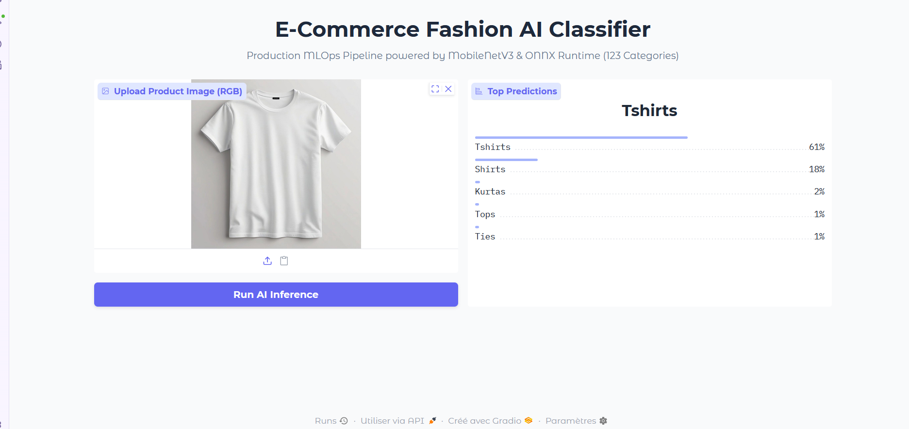
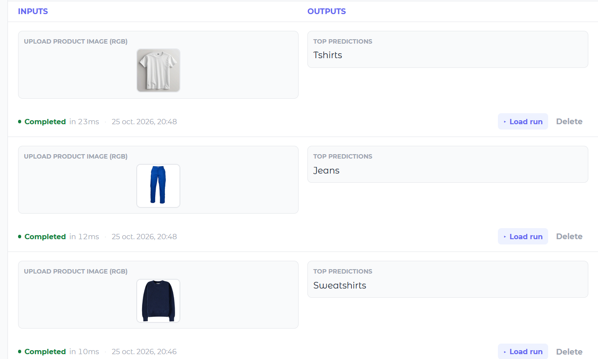
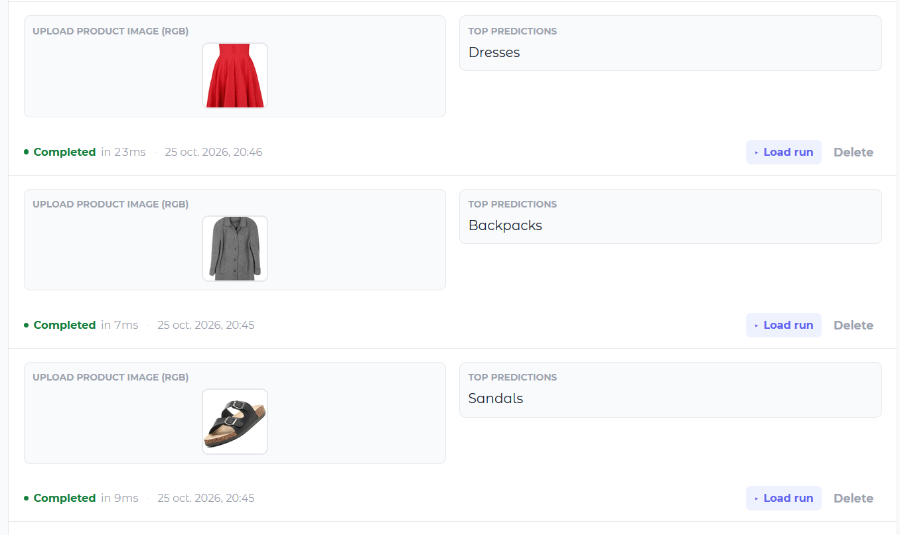
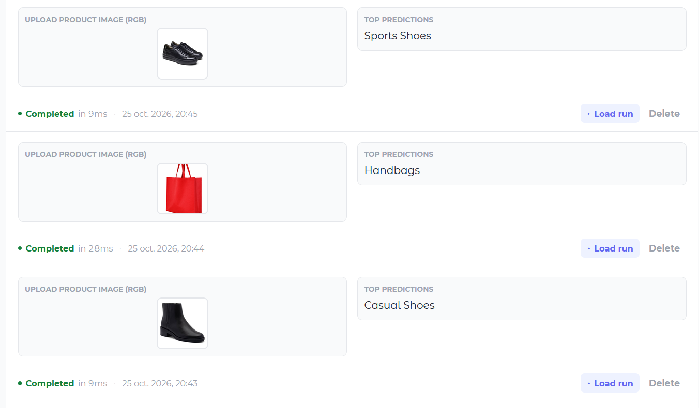
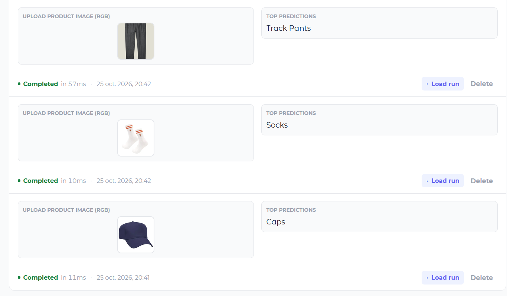
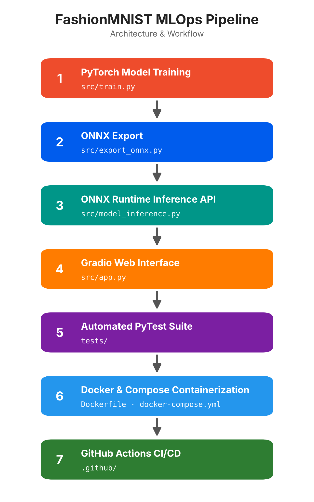

#  Fashion Production MLOps Pipeline

An end-to-end, production-ready Machine Learning pipeline for **Fashion** image classification. This repository demonstrates modern MLOps best practices, including PyTorch model training, ONNX export and runtime inference, automated testing with PyTest, containerization with Docker & Docker Compose, a Gradio web interface, and CI/CD via GitHub Actions.


## Interface & Model Predictions

### Interface

<p align="center">
  
</p>

### Model Prediction

<p align="center">
  
</p>
<p align="center">
  
</p>
<p align="center">
  
</p>
<p align="center">
  
</p>

---

##  Table of Contents

- [Architecture & Workflow](#architecture--workflow)
- [Key Features](#key-features)
- [Project Structure](#project-structure)
- [Prerequisites](#prerequisites)
- [Local Setup & Execution](#local-setup--execution)
  - [Method 1: Native Python](#method-1-running-with-native-python)
  - [Method 2: Docker & Docker Compose](#method-2-running-with-docker--docker-compose)
- [CI/CD Pipeline](#-cicd-pipeline)
- [MLOps Best Practices Demonstrated](#-mlops-best-practices-demonstrated)

---

##  Architecture & Workflow

<p align="center">
  
</p>

---

##  Key Features

| Feature | Description |
|---|---|
| **Optimized Model Inference** | Uses **MobileNetV3-Small** (`mobilenet_v3_small` with `MobileNet_V3_Small_Weights`), trained with PyTorch, exported to ONNX, and served with high-performance ONNX Runtime. |
| **RESTful API & Web UI** | Fast inference via **FastAPI** (`src/model_inference.py`) alongside an interactive **Gradio** UI (`src/app.py`). |
| **Modular Codebase** | Clean separation of concerns across training, dataset handling, ONNX conversion, inference engine, UI, and tests. |
| **Automated Testing** | Unit and integration tests covering preprocessing, ONNX engine execution, and API endpoints using PyTest and FastAPI `TestClient`. |
| **Containerization** | Full containerization via `Dockerfile` and `docker-compose.yml` for seamless multi-service execution. |
| **Continuous Integration** | Automated build and test workflow managed by GitHub Actions (`.github/workflows/ci.yml`). |

---

##  Project Structure
```
fashion-mlops-pipeline/
├── .github/
│   └── workflows/
│       └── ci.yml                      # GitHub Actions CI pipeline
├── assets/
│   ├── interface.png                   # Gradio interface screenshot
│   ├── model_classification1.png       # Model prediction example 1
│   ├── model_classification2.png       # Model prediction example 2
│   ├── model_classification3.png       # Model prediction example 3
│   ├── model_classification4.png       # Model prediction example 4
│   └── pipeline_architecture.png       # Architecture & workflow diagram
├── data/
│   ├── class_names.json                # Class label mapping file
│   ├── fashion_full_dataset.csv        # Raw dataset (excluded via .gitignore)
│   └── images/                         # Sample images (excluded via .gitignore)
├── models/
│   ├── fashion_cnn.onnx                # Exported ONNX model
│   ├── fashion_cnn.onnx.data           # ONNX external weights data
│   └── fashion_cnn.pth                 # PyTorch checkpoint
├── src/
│   ├── app.py                          # Gradio Web UI entry point
│   ├── dataset.py                      # PyTorch Dataset & DataLoaders
│   ├── export_onnx.py                  # PyTorch → ONNX conversion script
│   ├── model_inference.py              # FastAPI backend & ONNX Runtime engine
│   └── train.py                        # Model training logic
├── tests/
│   └── test_pipeline.py                # Automated PyTest test suite
├── .dockerignore                       # Files excluded from Docker builds
├── .gitignore                          # Git tracking exclusions
├── Dockerfile                          # Container definition for backend API
├── docker-compose.yml                  # Multi-container orchestration (API + UI)
├── README.md                           # Project documentation
└── requirements.txt                    # Python dependencies
```
---

##  Prerequisites

- **Python** 3.10 or higher
- **Docker & Docker Compose** installed and running (for the containerized setup)
- **Git** installed on your local machine

---

##  Local Setup & Execution

### Method 1: Running with Native Python

**1. Clone the repository**

```bash
git clone https://github.com/Diraribnsalah/fashion-mlops-pipeline.git
cd fashion-mlops-pipeline
```

**2. Create and activate a virtual environment**

Linux / macOS:

```bash
python3 -m venv .venv
source .venv/bin/activate
```

Windows (PowerShell):

```powershell
python -m venv .venv
.venv\Scripts\Activate.ps1
```

**3. Install dependencies**

```bash
pip install --upgrade pip
pip install -r requirements.txt
```

**4. Run the automated tests**

```bash
python -m pytest tests/ -v
```

**5. Start the services**

*Option A — FastAPI Inference Server*

```bash
uvicorn src.model_inference:app --reload --host 127.0.0.1 --port 8000
```

API docs: <http://127.0.0.1:8000/docs>

*Option B — Gradio Web Interface*

```bash
python src/app.py
```

Web UI: <http://127.0.0.1:7860>

---

### Method 2: Running with Docker & Docker Compose

**1. Run all services (API & UI)**

```bash
docker-compose up --build
```

**2. Access the applications**

| Service | URL |
|---|---|
| FastAPI Documentation | <http://localhost:8000/docs> |
| Gradio Web Interface | <http://localhost:7860> |

**3. Stop the services**

```bash
docker-compose down
```

---

##  CI/CD Pipeline

The project includes an automated Continuous Integration pipeline using **GitHub Actions**.

- **Workflow file:** `.github/workflows/ci.yml`
- **Triggers:** every `push` or `pull_request` to the `main` or `master` branches
- **Actions performed:**
  1. Sets up a Python 3.10 environment
  2. Installs dependencies from `requirements.txt`
  3. Runs `pytest tests/ -v` to verify preprocessing, model loading, ONNX runtime, and FastAPI endpoints

---

##  MLOps Best Practices Demonstrated

- **Modular Design:** strictly isolated modules for dataset handling, training, exporting, testing, and UI serving.
- **Interoperability & Performance:** model exported to ONNX for framework-agnostic, low-latency inference.
- **Hermetic Testing:** isolated API and unit tests using `pytest` and `httpx` / `TestClient`.
- **Reproducibility:** environment locked via `requirements.txt` and containerized using multi-stage Docker builds.
- **Continuous Quality Assurance:** automated code verification on every commit via GitHub Actions.


          
